# Digital Forensics Investigation

**Windows Laptop & iPhone Evidence Analysis | Academic Case Study**

  

## Overview

This repository documents a **simulated digital forensic investigation** completed during my BSc (Hons) Cybersecurity degree at Coventry University London. The academic scenario involved suspected counterfeit-currency activity and examination of university-provided laptop and iPhone forensic datasets.

I documented evidence handling, created and verified forensic working images, examined Windows and mobile artefacts, correlated findings and prepared an **expert witness-style report**. The project demonstrates practical investigative methodology and careful interpretation of digital evidence.

> **Scope:** This was a university exercise, not an actual police investigation or professional expert-witness engagement. Case identities, financial information and investigative documents belong to the simulated scenario.

## At a Glance

| Area | What I did |
| --- | --- |
| Evidence handling | Documented evidence identification and chain-of-custody procedures |
| Acquisition | Used SafeBlock and FTK Imager during forensic imaging workflows |
| Integrity | Checked forensic image verification results using MD5 hashes |
| Windows analysis | Examined file-system, recent-device, printer-related and web artefacts in Autopsy |
| Mobile analysis | Reviewed Telegram messages and application location artefacts using iLEAPP |
| Correlation | Considered relationships among communications, device activity, transactions and locations |
| Reporting | Produced a structured expert witness-style academic report with an audit trail |

## Tools

**SafeBlock** · **FTK Imager** · **Autopsy** · **iLEAPP** · **WiGLE** · **MD5 / SHA-1 verification**

## Investigation Workflow

### 1. Evidence Handling and Documentation

The exercise began with a staged forensic scene and documented handling of evidence. I recorded the handling process using evidence and chain-of-custody forms.

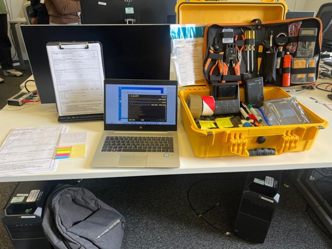

*Figure 1. Academic forensic workstation and evidence-handling setup.*

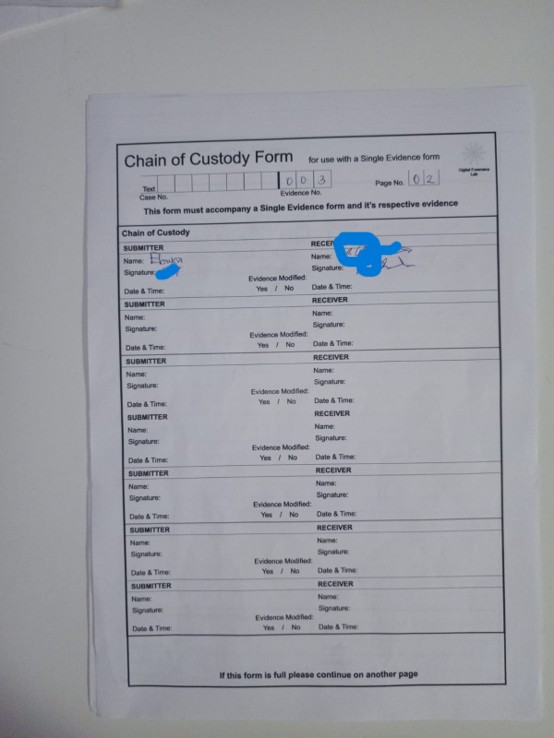

*Figure 2. Chain-of-custody documentation (signatures and third-party identifiers redacted).*

### 2. Evidence Acquisition and Verification

I worked with university-provided USB media containing the forensic datasets. I used SafeBlock as part of the evidence-preservation workflow and FTK Imager to document image acquisition. The image verification screens show matching MD5 values for the laptop and iPhone evidence copies.

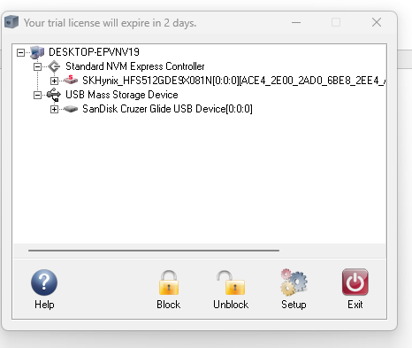

*Figure 3. SafeBlock interface identifying the connected USB device. This image does not, by itself, demonstrate the device's active write-block status.*

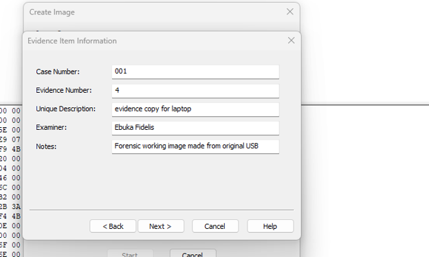

*Figure 4. Laptop image acquisition metadata entered in FTK Imager.*

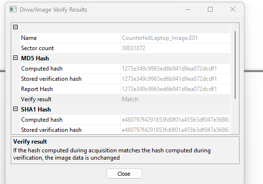

*Figure 5. Laptop E01 image verification: the displayed computed and stored MD5 hashes match.*

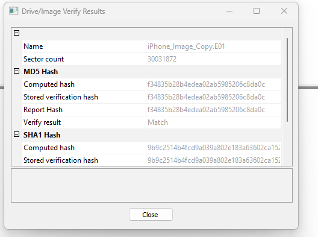

*Figure 6. iPhone evidence image verification: the displayed computed and stored MD5 hashes match.*

**Why it matters:** Verifying hashes provides a documented check that the image data has not changed between acquisition and verification. Hash matching alone does not establish the origin or authenticity of the underlying evidence.

### 3. Windows Laptop Examination — Autopsy

I used Autopsy to navigate the laptop's forensic image and examine artefacts relevant to the fictional investigation, including user files, recent device activity and recovered web content.

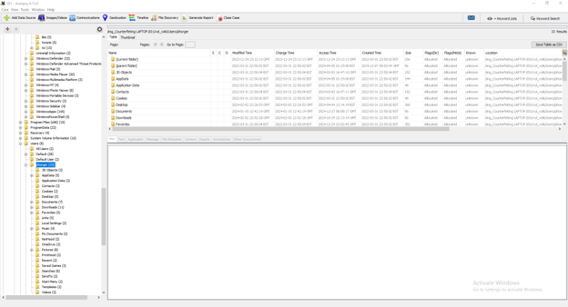

*Figure 7. Examining the Windows user directory and file-system artefacts in Autopsy.*

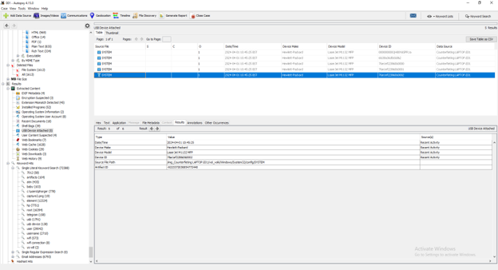

*Figure 8. Recent attached-device records showing Hewlett-Packard LaserJet entries. These records suggest printer-related device activity but do not independently prove what was printed.*

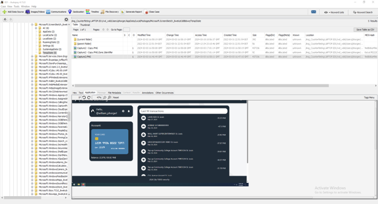

*Figure 9. Banking-related webpage content located among the examined Windows artefacts. Account and card details are redacted.*

### 4. iPhone Examination — iLEAPP

I used iLEAPP to review application artefacts in the supplied iPhone dataset. The Telegram records contained messages relevant to the simulated case, while cached Uber locations offered additional leads for timeline and location analysis.

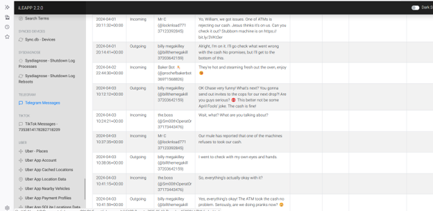

*Figure 10. Telegram message records examined in iLEAPP; unnecessary identifiers have been redacted.*

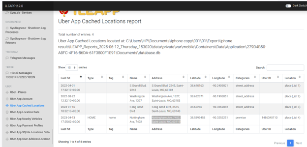

*Figure 11. Cached Uber application location records with timestamps. Cached locations are investigative leads, not conclusive proof of a person's physical presence.*

### 5. Supplementary Location Research — WiGLE

I also used WiGLE to research wireless-network location information as part of the academic investigation. WiGLE can help contextualise a network identifier, but a mapped network location does not by itself establish that a particular device or person was there.

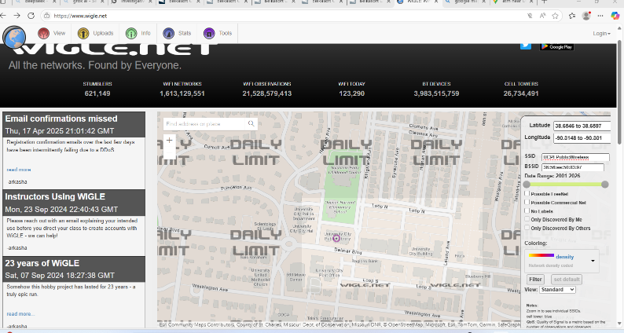

*Figure 12. WiGLE research interface used to investigate wireless-network location information.*

## Findings and Interpretation

The investigation produced several **potentially relevant leads**, rather than a single artefact that proved the fictional allegation:

- **Printer-related records:** Attached-device artefacts indicated activity associated with LaserJet devices, meriting further examination in the context of the simulated counterfeit-currency scenario.
- **Financial web artefacts:** Banking-related content was identified during laptop examination and considered alongside other case information.
- **Communications:** Telegram records provided context about activities discussed by fictional case participants.
- **Location data:** Mobile application records and supplementary WiGLE research provided possible geographic leads, with important limits on what they could establish.

I assessed these sources together, documented where they supported the investigative narrative and avoided treating individual artefacts as conclusive proof of wrongdoing.

## Skills Demonstrated

- Forensic evidence handling and documentation
- Forensic imaging workflows and integrity verification
- Windows artefact analysis using Autopsy
- iOS application artefact analysis using iLEAPP
- Timeline development and cross-source evidence correlation
- Critical evaluation of findings and evidential limitations
- Technical reporting and clear presentation of investigative results

## Ethics, Permissions and Limitations

- The case was an **academic simulation** using university-provided evidence, not a live criminal investigation.
- Published screenshots are selected and redacted; no original forensic disk images, credentials or raw mobile datasets are included.
- Screenshots are presented as illustrations of the workflow and must be interpreted alongside their captions.
- Findings describe artefacts observed in the supplied datasets; they are not independent proof of real-world criminal activity.
- This repository does not claim law-enforcement authority, professional forensic accreditation or an actual expert-witness appointment.

## Author

**Ebuka Fidelis**  
BSc (Hons) Cybersecurity — First Class Honours  
CompTIA A+ Certified  
[LinkedIn](https://www.linkedin.com/in/ebukafidelis) · [GitHub](https://github.com/worldbest402)
